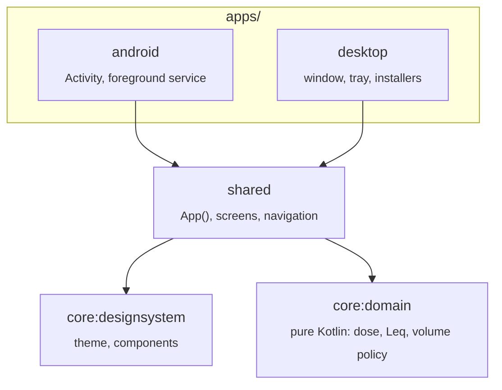

<div align="center">

# 🌊 WaveHeaven Lambda

**A safe-listening companion that adapts your volume to the world around you — and keeps count of what your ears can take.**

[](https://github.com/JeanCarloLond/WHLambda/actions/workflows/ci.yml)
[](LICENSE)


[](CONTRIBUTING.md#commit-messages)

</div>

> [!NOTE]
> **Status: Phase 0 — foundations.** The architecture, tooling and the hearing-dose model are in place;
> the adaptive-volume engine is next. See the [roadmap](docs/roadmap.md).

## Table of contents

- [Why](#why)
- [What it does](#what-it-does)
- [Platforms](#platforms)
- [Architecture](#architecture)
- [Getting started](#getting-started)
- [Project structure](#project-structure)
- [Development workflow](#development-workflow)
- [Documentation](#documentation)
- [Contributing](#contributing) · [Security](#security) · [License](#license) · [Acknowledgements](#acknowledgements)

## Why

On a bus, at the gym or in a busy café we turn the volume up to hear over the noise — and without noticing,
we spend our ears' daily budget in a couple of hours. The WHO estimates that over a billion young people are at
risk of hearing loss from unsafe listening.

WaveHeaven Lambda keeps music audible in noisy places **without** letting you cross a safe dose:

1. It **measures** ambient noise on-device.
2. It **adapts** the media volume to keep a comfortable margin over that noise.
3. It **caps** that volume by the exposure dose you have left today and this week (WHO / ITU-T H.870, NIOSH).
4. It **explains** what is happening, so safe listening becomes a habit rather than a restriction.

This is a ground-up remaster of [WaveHeaven](https://github.com/AGR-23/WaveHeaven), a university project whose idea
outgrew what a web page can do: a browser cannot control the volume of other apps. Lambda moves to native platforms
that can.

## What it does

| Capability                                                               | Status     |
| ------------------------------------------------------------------------ | ---------- |
| Exposure-dose model (WHO adult/sensitive, NIOSH), Leq                    | ✅ Done    |
| Shared UI, theming (WCAG AA), English/Spanish                            | ✅ Done    |
| Ambient-noise metering on-device (no audio recorded)                     | 🔜 Phase 1 |
| Adaptive volume for any music app (target SNR, capped by remaining dose) | 🔜 Phase 1 |
| Listening profiles per environment (commute, gym, office…)               | 🔜 Phase 1 |
| Daily/weekly dose dashboard and notifications                            | 🔜 Phase 1 |
| Desktop: per-app volume (Windows WASAPI, Linux PipeWire)                 | 🗓️ Phase 2 |
| Account & sync of aggregated stats (Supabase)                            | 🗓️ Phase 3 |
| Hearing check (not a diagnosis) feeding a personal EQ curve              | 🗓️ Phase 3 |
| Learns your preferred margin from manual adjustments                     | 🗓️ Phase 4 |

> [!IMPORTANT]
> WaveHeaven Lambda is **not a medical device**. If you notice ringing, muffled hearing or pain, see an audiologist.

## Platforms

| Platform                     | Role                                                                                                                 |
| ---------------------------- | -------------------------------------------------------------------------------------------------------------------- |
| **Android** (10+, API 29)    | Primary. Full experience: background metering and system media volume control.                                       |
| **Desktop** (Windows, Linux) | Full experience on PC via per-application volume control.                                                            |
| Web                          | Possible later (Compose for Web/Wasm) for dashboards; browsers cannot control app audio.                             |
| iOS                          | Out of scope: iOS does not let apps set the system volume. See [ADR-0002](docs/adr/0002-platforms-android-first.md). |

## Architecture

Kotlin Multiplatform with Compose Multiplatform: **one language, one domain model and one UI** for Android and
desktop, with platform-specific code only where the OS demands it (audio capture, volume control).



Dependencies point inwards: `core:domain` knows nothing about Android, Compose or the network, so the rules that
protect people's hearing are testable in milliseconds. Details in [docs/architecture.md](docs/architecture.md).

**Stack:** Kotlin 2.4 · Compose Multiplatform 1.12 · Material 3 · AGP 9 · Gradle 9 (version catalog + convention
plugins) · Supabase (planned) · detekt · ktlint/Spotless · Kover · Android Lint · GitHub Actions · Dependabot.

## Getting started

### Prerequisites

| Tool        | Version                                                               | Notes                                                                                |
| ----------- | --------------------------------------------------------------------- | ------------------------------------------------------------------------------------ |
| JDK         | 21                                                                    | e.g. [Temurin](https://adoptium.net/). Gradle provisions other toolchains if needed. |
| Android SDK | API 37                                                                | Via Android Studio, or command-line tools with `ANDROID_HOME` set.                   |
| Node.js     | 22+                                                                   | Only for git hooks and commit linting — not needed to build the apps.                |
| IDE         | Android Studio or IntelliJ IDEA with the Kotlin Multiplatform plugin. |

### Setup

```bash
git clone https://github.com/JeanCarloLond/WHLambda.git
cd WHLambda
npm install          # installs git hooks (commit-msg, pre-commit, pre-push)
./gradlew build      # compiles everything and runs all checks
```

### Run

```bash
./gradlew :apps:desktop:run                 # desktop app
./gradlew :apps:android:installDebug        # Android app on a connected device/emulator
```

### Common tasks

| Command                                                   | What it does                                            |
| --------------------------------------------------------- | ------------------------------------------------------- |
| `./gradlew check`                                         | Everything CI runs: tests, detekt, ktlint, Android Lint |
| `./gradlew desktopTest`                                   | Fast unit + UI tests on the JVM                         |
| `./gradlew spotlessApply`                                 | Auto-format Kotlin and Gradle files                     |
| `./gradlew koverHtmlReport`                               | Coverage report → `build/reports/kover/html/`           |
| `./gradlew :apps:desktop:packageDistributionForCurrentOS` | MSI on Windows, DEB/RPM on Linux                        |
| `npm run format`                                          | Format Markdown, YAML and JSON with Prettier            |

## Project structure

```
WHLambda/
├── apps/
│   ├── android/          Android application (entry point only)
│   └── desktop/          Compose Desktop application + installers
├── shared/               Shared UI: App(), screens, string resources (en, es)
├── core/
│   ├── domain/           Pure Kotlin business rules — no platform dependencies
│   └── designsystem/     Theme, colours, reusable components
├── build-logic/          Gradle convention plugins (one place for build config)
├── config/detekt/        Static-analysis rules
├── docs/                 Architecture, ADRs, domain notes, roadmap
└── gradle/libs.versions.toml   Single source of truth for versions
```

## Development workflow

- **Trunk-based:** short-lived branches off `main`, merged through pull requests with **squash merge**.
- **Branch names:** `<type>/<issue>-<short-description>`, e.g. `feat/12-noise-meter`.
- **Commits & PR titles:** `<gitmoji> <type>(<scope>): <subject>` — e.g. `✨ feat(core): add NIOSH dose model`.
  Enforced by a git hook and by CI.
- **Definition of done:** acceptance criteria demonstrated by tests or a demo, CI green, docs updated.

The full guide — commit table, scopes, review rules — is in [CONTRIBUTING.md](CONTRIBUTING.md).

## Documentation

| Document                                                       | Contents                                                 |
| -------------------------------------------------------------- | -------------------------------------------------------- |
| [docs/architecture.md](docs/architecture.md)                   | Modules, dependency rules, where new code goes           |
| [docs/adr/](docs/adr/)                                         | Architecture Decision Records — the _why_ behind choices |
| [docs/domain/hearing-safety.md](docs/domain/hearing-safety.md) | Exposure standards and the maths behind the dose model   |
| [docs/roadmap.md](docs/roadmap.md)                             | Phases and milestones                                    |
| [docs/legacy.md](docs/legacy.md)                               | What we learned from the original WaveHeaven             |

## Contributing

Contributions are welcome! Please read [CONTRIBUTING.md](CONTRIBUTING.md) and our
[Code of Conduct](CODE_OF_CONDUCT.md) first.

## Security

Please report vulnerabilities privately — see [SECURITY.md](SECURITY.md).

## License

Licensed under the [Apache License 2.0](LICENSE).

## Acknowledgements

WaveHeaven was created by **Jean Carlo Londoño** and **Alejandro Garcés** (with Emanuel González Quintero)
as a university project at EAFIT. Lambda carries its idea forward.
