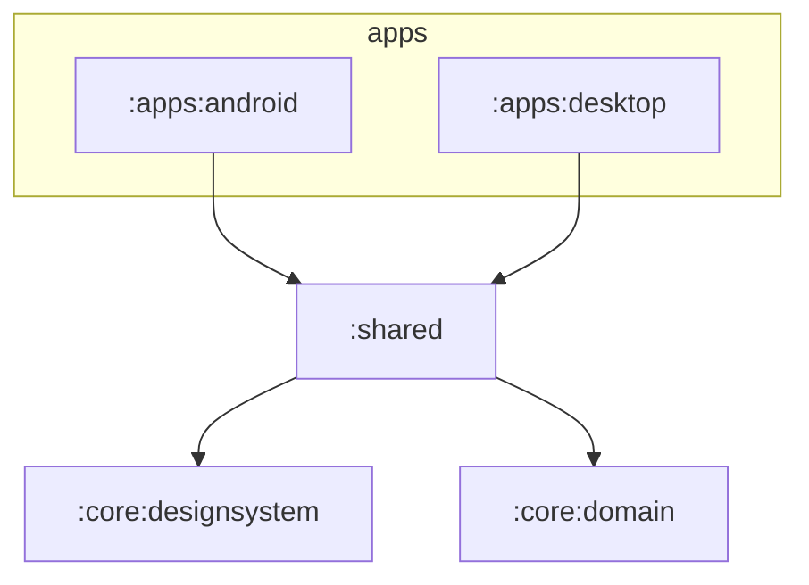

# Architecture

WaveHeaven Lambda is a **Kotlin Multiplatform** (KMP) project with a **Compose Multiplatform** UI. The goal is one
language, one domain model and one UI for every platform we ship (Android and desktop), with platform code only
where the operating system requires it. The stack choice is recorded in [ADR-0003](adr/0003-kotlin-multiplatform.md).

## Modules



| Module               | Kind                     | Responsibility                                                                                                   | May depend on      |
| -------------------- | ------------------------ | ---------------------------------------------------------------------------------------------------------------- | ------------------ |
| `:core:domain`       | KMP library, pure Kotlin | Business rules: exposure dose, Leq, volume policy, profiles. Defines _ports_ (interfaces) for the outside world. | Kotlin stdlib only |
| `:core:designsystem` | KMP + Compose            | Theme, colour tokens, typography, reusable components                                                            | Compose            |
| `:shared`            | KMP + Compose            | `App()`, screens, navigation, string resources                                                                   | `core:*`           |
| `:apps:android`      | Android application      | Activity, manifest, foreground service, platform wiring                                                          | `shared`           |
| `:apps:desktop`      | JVM application          | Window, tray, installers, platform wiring                                                                        | `shared`           |

### Planned modules

Modules are created when they have code, never empty. Expected next:

| Module        | Phase | Responsibility                                                                                                                                                                             |
| ------------- | ----- | ------------------------------------------------------------------------------------------------------------------------------------------------------------------------------------------ |
| `:core:audio` | 1     | `expect`/`actual` adapters for the domain ports: microphone metering (Android `AudioRecord`, desktop `javax.sound`), media volume (Android `AudioManager`, Windows WASAPI, Linux PipeWire) |
| `:core:data`  | 1     | Local persistence of aggregated exposure (SQLDelight), repositories                                                                                                                        |
| `:core:sync`  | 3     | Supabase client (auth, sync of aggregates)                                                                                                                                                 |
| `:feature:*`  | 1+    | One module per feature (`exposure`, `profiles`, `onboarding`, `hearing-check`) once `:shared` grows                                                                                        |

## Dependency rules

1. **Dependencies point inwards.** `apps → shared → core`. Nothing in `core` depends on `shared` or `apps`.
2. **`core:domain` is pure.** No Android, no Compose, no I/O, no coroutines dispatchers. It describes _what_ must
   happen; adapters in other modules decide _how_. This is what makes hearing-safety rules fast and exhaustive
   to test.
3. **Platform APIs live behind ports.** The domain declares an interface (e.g. `VolumeController`); each platform
   provides an implementation. The domain never imports `android.*` or `javax.*`.
4. **`apps/*` are thin.** They wire things together and host OS-mandated components (activities, services,
   installers). Logic found there is a smell.

## Source sets inside a KMP module

```
src/
├── commonMain/      code for every platform (most code lives here)
├── commonTest/      tests run on the desktop JVM *and* the Android host JVM
├── androidMain/     Android `actual` implementations
├── desktopMain/     desktop JVM `actual` implementations
└── desktopTest/     desktop-only tests (e.g. Compose UI tests, which need Skia)
```

## Build configuration

- **Versions** live only in [`gradle/libs.versions.toml`](../gradle/libs.versions.toml).
- **Build logic** lives in convention plugins under [`build-logic/`](../build-logic/), so module build files stay
  a few lines long:

  | Plugin id                      | Applies                                                            |
  | ------------------------------ | ------------------------------------------------------------------ |
  | `whlambda.kmp.library`         | KMP (Android + desktop targets), detekt, Kover, warnings-as-errors |
  | `whlambda.kmp.compose`         | the above + Compose Multiplatform                                  |
  | `whlambda.android.application` | Android app, Compose, Lint (warnings-as-errors), detekt            |
  | `whlambda.desktop.application` | Compose Desktop app, detekt                                        |
  | `whlambda.detekt`              | detekt with shared config and Compose rules                        |

- **Namespaces** are derived from the module path: `:core:domain` → `com.waveheaven.lambda.core.domain`.

## Cross-cutting decisions

| Concern          | Decision                                                                                       |
| ---------------- | ---------------------------------------------------------------------------------------------- |
| Hearing safety   | WHO/ITU-T H.870 and NIOSH dose model — see [hearing-safety.md](domain/hearing-safety.md)       |
| Privacy          | On-device processing, only aggregates stored — [ADR-0007](adr/0007-privacy-on-device-audio.md) |
| Volume behaviour | Target SNR capped by remaining dose — [ADR-0006](adr/0006-adaptive-volume-policy.md)           |
| Backend          | Supabase — [ADR-0004](adr/0004-supabase-backend.md)                                            |
| i18n             | Compose resources, English default + Spanish, from day one                                     |
| Accessibility    | WCAG 2.2 AA contrast, semantics on interactive elements, alerts never sound-only               |
