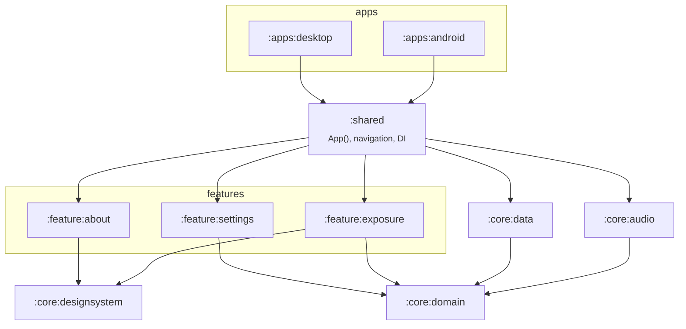
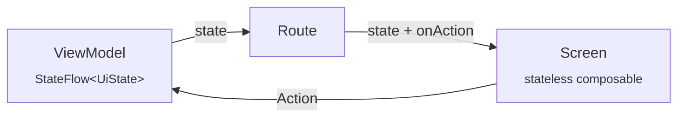

# Architecture

WaveHeaven Lambda is a **Kotlin Multiplatform** (KMP) project with a **Compose Multiplatform** UI. The goal is one
language, one domain model and one UI for every platform we ship (Android and desktop), with platform code only
where the operating system requires it. The stack choice is recorded in [ADR-0003](adr/0003-kotlin-multiplatform.md);
navigation, dependency injection and the screen pattern in [ADR-0008](adr/0008-navigation-di-and-screen-pattern.md).

## Modules



| Module               | Kind                     | Responsibility                                                                                                       | May depend on         |
| -------------------- | ------------------------ | -------------------------------------------------------------------------------------------------------------------- | --------------------- |
| `:core:domain`       | KMP library, pure Kotlin | Business rules: exposure dose, Leq, volume controller, profiles. Defines _ports_ (interfaces) for the outside world. | Kotlin stdlib only    |
| `:core:designsystem` | KMP + Compose            | Theme, colour tokens, icons, reusable components                                                                     | Compose               |
| `:core:audio`        | KMP library              | A-weighting, level metering and calibration (common); Android adapters for the microphone and media-volume ports     | `core:domain`         |
| `:core:data`         | KMP library              | Local persistence (SQLDelight): implements storage ports such as `ExposureLog`; platform database drivers            | `core:domain`         |
| `:feature:*`         | KMP + Compose            | One user-facing capability: navigation key, screens, ViewModels, DI module, strings                                  | `core:*`              |
| `:shared`            | KMP + Compose            | App shell: `App()`, navigation graph, Koin setup                                                                     | `core:*`, `feature:*` |
| `:apps:android`      | Android application      | `Application`, activity, manifest, foreground service, platform wiring                                               | `shared`, `core:*`    |
| `:apps:desktop`      | JVM application          | `main`, window, tray, installers, platform wiring                                                                    | `shared`, `core:*`    |

### Planned modules

Modules are created when they have code, never empty. Expected next:

| Module       | Phase | Responsibility                                          |
| ------------ | ----- | ------------------------------------------------------- |
| `:core:sync` | 3     | Supabase client (auth, sync of aggregates)              |
| `:feature:*` | 1+    | `profiles`, `onboarding`, `dashboard`, `hearing-check`… |

## Dependency rules

1. **Dependencies point inwards.** `apps → shared → feature → core`. Nothing in `core` depends on anything above it.
2. **Features never depend on each other.** They communicate through navigation callbacks wired in `:shared`
   (e.g. `DoseExplorerRoute(onOpenAbout = { backStack.add(AboutKey) })`).
3. **`core:domain` is pure.** No Android, no Compose, no I/O, no coroutine dispatchers (ports may expose `Flow` types). It describes _what_ must
   happen; adapters in other modules decide _how_. This is what makes hearing-safety rules fast and exhaustive
   to test.
4. **Platform APIs live behind ports.** The domain declares an interface (e.g. reading and setting the media volume);
   each platform provides an implementation. The domain never imports `android.*` or `javax.*`.
5. **`apps/*` are thin.** They wire things together and host OS-mandated components (activities, services,
   installers). Logic found there is a smell.

## Screen pattern (unidirectional data flow)

Every screen with state or logic follows the same shape. [`feature:exposure`](../feature/exposure/) is the
reference implementation.



| Piece          | File                        | Rules                                                                                                       |
| -------------- | --------------------------- | ----------------------------------------------------------------------------------------------------------- |
| Navigation key | `…Contract.kt` / `…Key.kt`  | `@Serializable data object XKey : NavKey` (or `data class` with arguments)                                  |
| UI state       | `…Contract.kt`              | Immutable `data class`; everything the screen renders, already computed                                     |
| Actions        | `…Contract.kt`              | `sealed interface XAction`: one type per user intent                                                        |
| ViewModel      | `…ViewModel.kt`             | Owns one `StateFlow<XUiState>`; changes it only in `onAction`; no Compose or platform imports               |
| Route          | `…Screen.kt`                | `XRoute(…)`: gets the ViewModel with `koinViewModel()`, collects state with `collectAsStateWithLifecycle()` |
| Screen         | `…Screen.kt`                | `XScreen(state, onAction, …, modifier)`: stateless, previewable, UI-tested in isolation                     |
| DI module      | `…Module.kt`                | `val xModule = module { viewModelOf(::XViewModel) }`, registered in `:shared` `appModules`                  |
| Strings        | `composeResources/values*/` | English default + `values-es`; generated `Res` lives in `<module package>.resources`                        |

Screens without state or logic (e.g. [`AboutScreen`](../feature/about/)) skip the ViewModel: a stateless
composable plus its key is enough.

### Navigation

Navigation 3: the back stack is a plain list of keys owned by
[`AppNavigation`](../shared/src/commonMain/kotlin/com/waveheaven/lambda/shared/navigation/AppNavigation.kt).
Navigating means `backStack.add(key)` / `backStack.removeLastOrNull()`. Each entry gets its own saved state and
ViewModel store, released when the entry leaves the stack.

### Adding a feature — checklist

1. `include(":feature:<name>")` in `settings.gradle.kts`.
2. `feature/<name>/build.gradle.kts` with `plugins { alias(libs.plugins.whlambda.kmp.feature) }`.
3. Contract (key, state, actions), ViewModel, Route + Screen, DI module, strings (`en` + `es`).
4. In `:shared`: add the module dependency, register the DI module in `appModules`, add an `entry<XKey>` to the
   navigation graph **and** register the key in `NavigationConfig`.
5. Tests: ViewModel in `commonTest`, Screen in `desktopTest`; extend `AppTest` if navigation changes.

## Persistence

`:core:data` keeps everything the app stores in one SQLite database (`waveheaven.db`), through SQLDelight:

- **Ports first.** The domain declares what it needs (`ExposureLog`); `:core:data` implements it (`SqlExposureLog`).
  Features and services depend on the port, so they test with in-memory fakes (`InMemoryExposureLog`).
- **Aggregates only.** Exposure is stored as one row per minute (`ExposureMinute`), never audio
  ([ADR-0007](adr/0007-privacy-on-device-audio.md)). Rows older than 30 days are deleted when new ones are recorded.
- **Migrations are the schema.** Each change is a new numbered file (`1.sqm`, `2.sqm`, …) next to the queries in
  `core/data/src/commonMain/sqldelight/`; SQLDelight derives the schema and the version from them. Never edit a
  migration that is on `main`.
- **Drivers per platform.** Each app binds a `SqlDriver` in Koin: `createAndroidDriver(context)` (app-private
  storage, excluded from backups) or `createDesktopDriver()` (per-user data directory). Tests use an in-memory
  JDBC driver.

## Source sets inside a KMP module

```
src/
├── commonMain/      code for every platform (most code lives here)
├── commonTest/      tests run on the desktop JVM *and* the Android host JVM
├── androidMain/     Android `actual` implementations
├── desktopMain/     desktop JVM `actual` implementations
└── desktopTest/     desktop-only tests (e.g. Compose UI tests, which need Skia)
```

## Build configuration

- **Versions** live only in [`gradle/libs.versions.toml`](../gradle/libs.versions.toml).
- **Build logic** lives in convention plugins under [`build-logic/`](../build-logic/), so module build files stay
  a few lines long:

  | Plugin id                      | Applies                                                                          |
  | ------------------------------ | -------------------------------------------------------------------------------- |
  | `whlambda.kmp.library`         | KMP (Android + desktop targets), detekt, Kover, warnings-as-errors               |
  | `whlambda.kmp.compose`         | the above + Compose Multiplatform, Android resources                             |
  | `whlambda.kmp.feature`         | the above + serialization, ViewModel, Navigation 3, Koin, `core:*`, test tooling |
  | `whlambda.android.application` | Android app, Compose, Lint (warnings-as-errors), detekt                          |
  | `whlambda.desktop.application` | Compose Desktop app, detekt                                                      |
  | `whlambda.detekt`              | detekt with shared config and Compose rules                                      |

- **Namespaces** are derived from the module path: `:core:domain` → `com.waveheaven.lambda.core.domain`.

## Cross-cutting decisions

| Concern          | Decision                                                                                                                                  |
| ---------------- | ----------------------------------------------------------------------------------------------------------------------------------------- |
| Hearing safety   | WHO/ITU-T H.870 and NIOSH dose model — see [hearing-safety.md](domain/hearing-safety.md)                                                  |
| Volume behaviour | Target SNR capped by remaining dose — [ADR-0006](adr/0006-adaptive-volume-policy.md), [volume-controller.md](domain/volume-controller.md) |
| Desktop audio    | Per-app volume via WASAPI (JNA) and `pactl` — [ADR-0009](adr/0009-desktop-per-app-volume.md)                                              |
| Privacy          | On-device processing, only aggregates stored — [ADR-0007](adr/0007-privacy-on-device-audio.md)                                            |
| UI architecture  | Navigation 3, Koin, unidirectional data flow — [ADR-0008](adr/0008-navigation-di-and-screen-pattern.md)                                   |
| Backend          | Supabase — [ADR-0004](adr/0004-supabase-backend.md)                                                                                       |
| i18n             | Compose resources, English default + Spanish, from day one                                                                                |
| Accessibility    | WCAG 2.2 AA contrast, semantics on interactive elements, alerts never sound-only                                                          |
